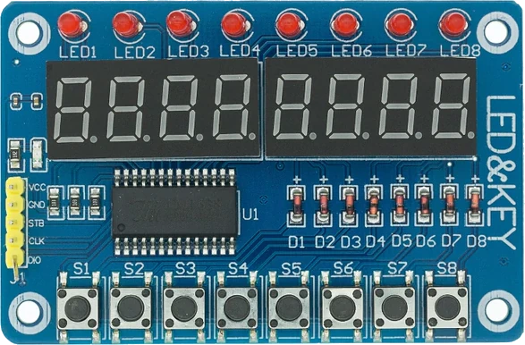

# TM1638

Arduino library for modules based on the TM1638 controller.

The library provides simple functions for

- 8 seven-segment displays
- 8 LEDs
- 8 push buttons
- Display brightness control

The interface uses only three GPIO pins.



[datasheet](https://cdn.shopify.com/s/files/1/2386/9605/files/tm1638.pdf?8132892906594134473)

https://fr.aliexpress.com/wholesale?SearchText=TM1638

## Features

- Read individual buttons or all buttons at once
- Control individual LEDs or all LEDs
- Display hexadecimal digits (0-F)
- Display raw segment bitmaps
- Adjustable brightness
- Display on/off control
- Reset and hardware test functions

---

# Wiring

| TM1638 | Arduino |
|---------|----------|
| STB | Any digital output |
| CLK | Any digital output |
| DIO | Any digital I/O |

Example:

```cpp
TM1638 display(2, 3, 4);
//              CLK DIO STB
```

---

# Creating an object

```cpp
#include <TM1638.h>

TM1638 display(2,3,4);
```

Constructor

```cpp
TM1638(clkPin, dioPin, stbPin);
```

| Parameter | Description |
|------------|-------------|
| clkPin | Clock pin |
| dioPin | Data pin |
| stbPin | Strobe (Chip Select) pin |

---

# Public Methods

## reset()

Clears everything.

- All digits off
- All LEDs off

```cpp
display.reset();
```

---

## displayVal()

Displays one hexadecimal digit.

```cpp
display.displayVal(position, value);
```

Parameters

| Parameter | Range |
|------------|------|
| position | 0-7 |
| value | 0-15 |

Example

```cpp
display.displayVal(0,10);   // A
display.displayVal(1,15);   // F
display.displayVal(2,5);    // 5
```

---

## displayDig()

Displays raw segment data.

```cpp
display.displayDig(position, bitmap);
```

The bitmap uses

```
bit7 bit6 bit5 bit4 bit3 bit2 bit1 bit0
 DP    G    F    E    D    C    B    A
```

Example

```cpp
display.displayDig(0,0b01111111);
```

Lights every segment except the decimal point.

---

## displayClear()

Turns off all seven-segment displays.

```cpp
display.displayClear();
```

LEDs are not affected.

---

## displayTurnOn()

Turns the display back on.

```cpp
display.displayTurnOn();
```

---

## displayTurnOff()

Turns off all display outputs without losing display memory.

```cpp
display.displayTurnOff();
```

---

## displaySetBrightness()

Sets display brightness.

```cpp
display.displaySetBrightness(PULSE10_16);
```

Available brightness levels

| Constant |
|----------|
| PULSE1_16 |
| PULSE2_16 |
| PULSE4_16 |
| PULSE10_16 |
| PULSE11_16 |
| PULSE12_16 |
| PULSE13_16 |
| PULSE14_16 |

Higher values produce a brighter display.

---

## writeLed()

Controls one LED.

```cpp
display.writeLed(1, ON);
display.writeLed(5, OFF);
```

Parameters

| Parameter | Range |
|-----------|------|
| LED | 1-8 |
| State | ON/OFF or true/false |

---

## writeLeds()

Controls all LEDs simultaneously.

```cpp
display.writeLeds(0b10101010);
```

Bit 0 controls LED1.

Bit 7 controls LED8.

---

## getButton()

Reads one button.

```cpp
if(display.getButton(S3))
{
    ...
}
```

Available button constants

```
S1
S2
S3
S4
S5
S6
S7
S8
```

Returns

```
true
false
```

---

## getButtons()

Reads all eight buttons.

```cpp
uint8_t keys = display.getButtons();
```

Bit mapping

```
Bit0 -> S1
Bit1 -> S2
Bit2 -> S3
Bit3 -> S4
Bit4 -> S5
Bit5 -> S6
Bit6 -> S7
Bit7 -> S8
```

---

## test()

Hardware test.

```cpp
display.test();
```

The function repeatedly flashes every LED and every segment.

Useful for verifying wiring.

---

# Constants

## Button constants

```cpp
S1
S2
S3
S4
S5
S6
S7
S8
```

---

## LED states

```cpp
ON
OFF
```

---

## Brightness

```cpp
PULSE1_16
PULSE2_16
PULSE4_16
PULSE10_16
PULSE11_16
PULSE12_16
PULSE13_16
PULSE14_16
```

---

# Example

```cpp
#include <TM1638.h>

TM1638 display(2,3,4);

void setup()
{
    display.reset();

    display.displaySetBrightness(PULSE14_16);

    display.displayVal(0,1);
    display.displayVal(1,2);
    display.displayVal(2,3);
    display.displayVal(3,4);

    display.writeLed(1,ON);
}

void loop()
{
    if(display.getButton(S1))
    {
        display.writeLed(8,ON);
    }
    else
    {
        display.writeLed(8,OFF);
    }
}
```

# License

MIT License.
